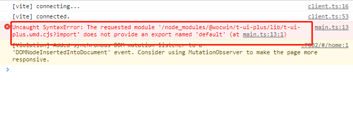

# Aura-UI

基于 Vue3 + TypeScript 的中后台业务型组件库文档

## 环境要求

- Node.js >= 16.x
- npm >= 8.x

## 安装依赖

```bash
npm install
```

## 运行项目

### 文档开发模式

```bash
npm run docs:dev
```

启动后访问 http://localhost:3300

### 构建文档

```bash
npm run docs:build
```

构建产物在 `docs/.vitepress/dist` 目录

### 构建组件库

```bash
npm run lib
```

构建产物在 `lib` 目录

## 项目结构

```
├── docs/                      # 文档目录
│   ├── .vitepress/           # VitePress 配置
│   ├── components/           # 组件文档
│   └── examples/             # 组件示例
├── packages/                  # 组件源码
│   ├── button/
│   ├── select/
│   └── ...
└── lib/                       # 组件库构建产物
```

## 组件列表

| 组件             | 说明           |
| ---------------- | -------------- |
| AuButton         | 按钮组件       |
| AuInput          | 输入框组件     |
| AuSelect         | 下拉选择组件   |
| AuSelectIcon     | 图标选择组件   |
| AuSelectTable    | 表格选择组件   |
| AuTable          | 表格组件       |
| AuForm           | 表单组件       |
| AuModuleForm     | 模块表单组件   |
| AuDatePicker     | 日期选择器组件 |
| AuDetail         | 详情组件       |
| AuTabs           | 标签页组件     |
| AuBreadcrumb     | 面包屑组件     |
| AuStepWizard     | 步骤向导组件   |
| AuDrawer         | 抽屉组件       |
| AuQueryCondition | 查询条件组件   |
| AuQueryTable     | 查询表格组件   |
| AuAdaptivePage   | 自适应页面组件 |
| AuMenu           | 菜单组件       |
| AuCheckbox       | 多选框组件     |
| AuRadio          | 单选框组件     |

## 在线文档

https://zhougree.github.io/aura-ui/

## License

MIT Volar 组件类型提示

```js
// 需要在使用的项目的tsconfig.json文件中添加以下
compilerOptions：{
  "types": [
      "aura-ui/components.d.ts",
    ],
}

```

## Vue3 + Vite 项目中安装引入报如下错误的解决方法

> #### 把项目的 vite 版本升级到 4+



## 安装依赖

> ### 注意: 本地环境版本最好安装 [Node.js 16.x+](https://nodejs.org/en)、[pnpm 7.x+](https://github.com/pnpm/pnpm/)

```shell
npm install -g pnpm

# 安装依赖
pnpm install --registry=https://registry.npmjs.org/
>pnpm config get registry 查看当前指向源

# 如果安装依赖失败，可以尝试使用淘宝镜像  --registry=https://registry.npmmirror.com/
>pnpm config set registry https://registry.npmmirror.com/ 切换淘宝镜像源
>pnpm install

```

## 本地运行 vuepress 中组件文档

```shell
// docs项目(文档demo示例)基于vue3+vite项目
npm run docs:dev

```

## Thanks to all the contributors

<a href="https://github.com/ZhouGree/aura-ui/graphs/contributors">
  
</a>

## Git 提交规范

- `ci`: ci 配置文件和脚本的变动;
- `chore`: 构建系统或辅助工具的变动;
- `fix`: 代码 BUG 修复;
- `feat`: 新功能;
- `perf`: 性能优化和提升;
- `refactor`: 仅仅是代码变动，既不是修复 BUG 也不是引入新功能;
- `style`: 代码格式调整，可能是空格、分号、缩进等等;
- `docs`: 文档变动;
- `test`: 补充缺失的测试用例或者修正现有的测试用例;
- `revert`: 回滚操作;
